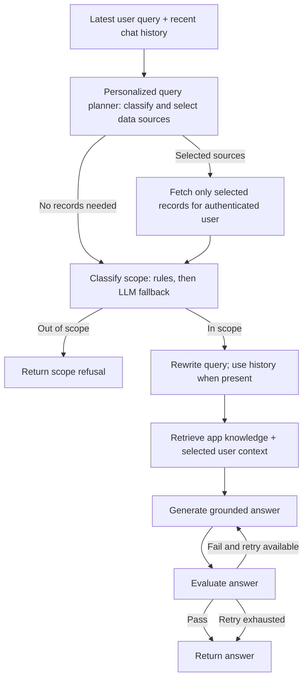

# Fizzi AI (Quick.AI Chatbot Service) — Prompt Reference

This document describes the system prompts used by Fizzi AI, the intelligent career assistant for Quick.AI. The classifier also has a deterministic fast path, and the evaluator may use a deterministic fallback depending on the LLM provider or an evaluation error.

## Pipeline

The classifier prompt categories are `application_help`, `application_changes`, `project_status`, and `out_of_scope`. The scope gate blocks `out_of_scope`; it does not itself execute application changes. The Quick.AI server authenticates chat requests and supplies the signed-in user's records. For personalized queries, the context planner selects only the needed sources before reading feature history. Clear first-person requests to review or analyze the user's resume deterministically select `resume_review`, so a planner model misclassification cannot suppress those records. For example, “What are the main drawbacks in my resume?” and “Based on my previous resume review, where should I improve for a senior engineer role?” select `resume_review`; the career goal guides analysis and does not trigger unrelated reads. Other personalized queries use the planner and a narrow keyword fallback. Selected tool history is limited to 20 rows, except Resume Review and Resume Tailor, which each use up to five. Job tracker queries can include up to 100 of that user's records. The query rewriter returns the original query unchanged when there is no history. Up to 20 recent user/assistant messages are sent for conversation context. Generation and evaluation can repeat according to the service retry configuration.

Resume Review and Resume Tailor keep the original extracted resume text for the five most recent records of each type, plus the result and (for tailoring) job description. Apply the database migration in `server/scripts/migrate.js` before relying on these new columns. Older records do not contain the original resume text, but their saved review or tailoring results remain available.

## Prompts

### 1. Intent classification

**Source:** `app/services/classifier.py` — `CLASSIFIER_SYSTEM_PROMPT`  
**Temperature:** 0.0  
**Output:** JSON with `is_relevant`, `category`, `reason`, and `confidence`.

Classifies Quick.AI product and career-tool questions, the user's own account/activity questions, greetings, action requests, and out-of-scope topics. The deterministic fast path runs before this prompt for recognized cues. Anything out of scope is rejected before retrieval.

### 2. Query rewriting

**Source:** `app/services/query_rewriter.py` — `QUERY_REWRITER_SYSTEM_PROMPT`  
**Temperature:** 0.0  
**Output:** JSON with `original_query`, `rewritten_query`, and `reason`.

Uses up to the last 20 history messages to clarify references. It preserves ambiguous wording rather than guessing, and it does not answer the query. Generation also receives up to 20 recent user/assistant messages.

### 3. Grounded answer generation

**Source:** `app/services/answer_generator.py` — `SYSTEM_PROMPT`  
**Temperature:** 0.2  
**Output:** Plain text or Markdown.

The user message contains the original and rewritten query, retrieved application and authorized user context, and optional retry guidance. The system prompt treats query, history, retrieved content, and retry guidance as untrusted data; it requires evidence-based answers, privacy, concise scope refusals, and no claimed or executed actions.

### 4. Answer evaluation

**Source:** `app/services/evaluator.py` — `EVALUATOR_SYSTEM_PROMPT`  
**Temperature:** 0.0  
**Output:** JSON with `is_satisfactory`, `relevance_score`, `grounding_score`, and `reason`.

The evaluator checks relevance, grounding, product/privacy boundaries, and unsupported action claims against the retrieved application documents and selected user records, including feature history. The service applies configured relevance and grounding thresholds. The configured retry loop may request another candidate when evaluation fails. Some providers use the deterministic evaluator instead of this prompt.

## Updating prompts

Edit the relevant constant in `app/services/`. Keep the JSON field names aligned with the service parsing code and Pydantic models. Update this reference when behavior or output fields change.
